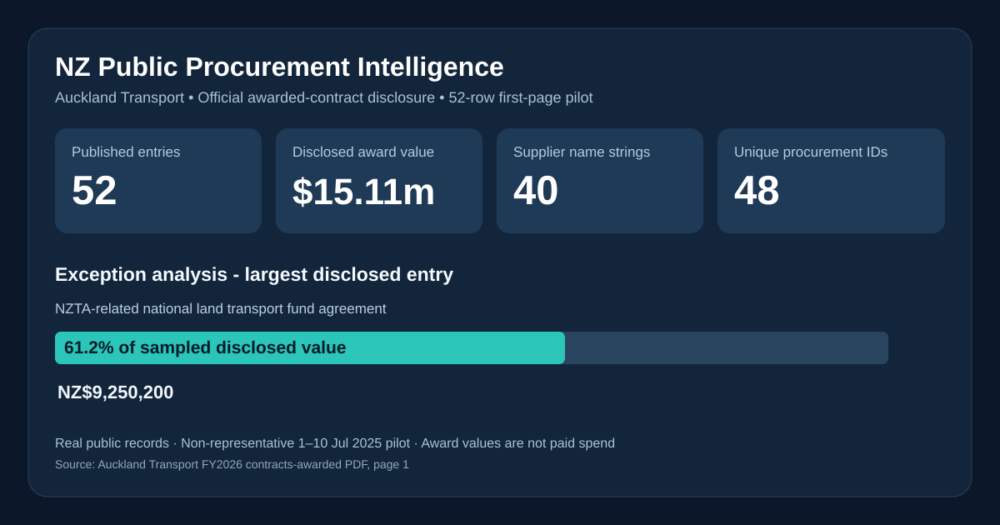

# New Zealand Public Procurement & Supplier Intelligence

**An independent Excel and business-analysis case study using real, publicly disclosed New Zealand contract-award entries.**



> **Reporting basis:** Auckland Transport FY2026 awarded-contract information; **first 52 entries from page 1** of one published PDF edition. Records were created between **1–10 July 2025**. This is a limited, **non-representative pilot sample**, not annual procurement spending and not a complete GETS feed. Source data are real public disclosures; the reporting model, QA and recommendations are independent analysis.

## At a glance — selected published entries only

| Measure | Evidence-based result | What it actually measures |
|---|---:|---|
| Published award entries | **52** | Rows in the sampled official report |
| Disclosed award value | **NZ$15,111,059.25** | Sum of reported award values, **not payments** |
| Supplier-name strings | **40** | Distinct textual supplier values, not NZBN-matched entities |
| Source category codes | **7** | Uninterpreted contract-category codes |
| Procurement numbers | **48 unique** | Three identifiers repeat on multiple entries; four extra occurrences |
| Largest entry | **NZ$9,250,200** | A published NZTA agreement-related entry |
| Largest entry share | **61.2%** | Dominates the selected pilot, not a population concentration estimate |

The strongest insight is a **data interpretation issue**: the sample contains a material NZTA agreement-related entry, which should be reviewed separately before drawing conclusions about external supplier concentration. An award value is not evidence that the amount has been paid, delivered or saved.

## Explore the project

| Audience | Recommended starting point |
|---|---|
| Purchasing manager / recruiter | [Business context and decisions](docs/01_business_case.md) → [Evidence-based findings](docs/04_findings.md) |
| Technical or data reviewer | [Raw published sample](data/auckland_transport_award_sample.csv) → [Data model & QA](docs/02_data_model_and_quality.md) |
| Excel reviewer | [Workbook](workbook/NZ_Public_Procurement_Awards_Intelligence.xlsx) → [Workbook walkthrough](docs/03_workbook_guide.md) |
| Reviewer checking provenance | [Official Auckland Transport PDF](https://at.govt.nz/media/xy2jwzgu/auckland-transport-latest-awarded-contracts-july-2026.pdf) → [Source and methodology](docs/05_sources_and_limitations.md) |

### Business decisions supported

- Understand **which published award entries and categories** drive disclosed value within the inspected sample.
- Direct follow-up research toward **high-value / unusual entries**, not automatically high-risk suppliers.
- Identify duplicate procurement numbers as **potentially legitimate multiple awarded line items**, rather than deduplicating away valid records.
- Design a reusable process for source attribution, KPI governance and reconciliation before scale-up.

### What the dataset does **not** establish

There are **no** underlying purchase orders, goods receipts, supplier invoice payments, shipment dates, stock-on-hand records, delivery promises, or legal-entity master matches. Therefore we do **not** calculate OTIF, PO lateness, stockouts, negotiated savings or actual spend. Date on the source is **Contract Created Date**, not necessarily signature date. The PDF does not state a GST treatment for values. <https://at.govt.nz/about-us/procurement/contracts-awarded>

## Excel structure

| Sheet | Purpose |
|---|---|
| `DASHBOARD` | Reported-value overview, exception narrative and category comparison |
| `AWARDS_DATA` | Each sourced entry with original supplier, procurement number, category, value, date and PDF attribution |
| `SUPPLIER_SCORECARD` | Supplier-string aggregation and explicitly *illustrative* value-concentration review flags |
| `CATEGORY_EXPOSURE` | Award entry and published-value breakdown by source category code |
| `DAILY_TREND` | Trend by contract-created date, not delivery or actual spend |
| `DATA_QA` | Formula-driven source-count, amount, missing-key and aggregate reconciliation checks |
| `KPI_DICTIONARY` | Definition, denominator and interpretation boundary for each metric |
| `SOURCE_LOG` | Publisher, document, grain, sample boundaries and uncertainties |
| `HOW_TO_USE` | Walkthrough for business and technical reviewers |

## Reproduce the public evidence

Requires **Python 3.10+**, standard library only:

```bash
python scripts/validate_and_summarise.py
```

This rebuilds `evidence/supplier_summary.csv`, `evidence/category_summary.csv`, `evidence/daily_summary.csv`, and `evidence/validation_summary.json` from the **included** source CSV. The original public PDF is linked in each row for manual source verification.

**Scope of reproducibility:** calculations over the published sample CSV are reproducible. **Initial PDF-to-CSV transcription was manually checked against the official PDF's first-page listing**, not automatically extracted by a verified PDF parsing pipeline. No real-world ERP, external entity matching or independent procurement audit is implied. If replacing the source with a complete dataset, validate the new extract and rewrite sample-specific acceptance thresholds first.

## Moving beyond the pilot

See [implementation roadmap](docs/06_scale_up_roadmap.md) for a full-report ingestion pipeline, supplier entity resolution, GETS joins, data-quality gates, and a refreshable reporting solution. The New Zealand Government Procurement [GETS open-data page](https://www.mbie.govt.nz/cross-government-functions/new-zealand-government-procurement-and-property/open-data) provides CSV and schema files covering notices through 30 June 2026, but **its underlying rows are not used in this pilot workbook**.

## Data use and ethics

Source: **Auckland Transport** publicly disclosed FY2026 awarded contracts. All cited names and values in the CSV were transcribed from the source disclosure; no synthetic procurement records were added. Code and original documentation can be reused under the [MIT licence](LICENSE); this licence does **not** purport to relicense the underlying Auckland Transport disclosures. Verify publisher terms before further redistribution.

*Project type: independent portfolio prototype | Real public records | Pilot scope: 52 report rows | No ERP integration, no independently measured operational improvement.*